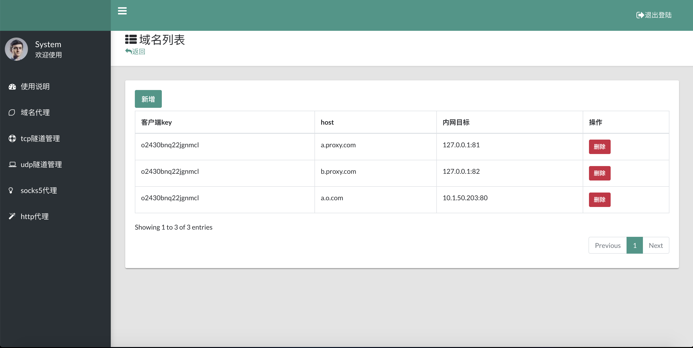

# nps
   
[](https://gitter.im/cnlh-nps/community?utm_source=badge&utm_medium=badge&utm_campaign=pr-badge)


[README](https://github.com/ehang-io/nps/blob/master/README.md)|[中文文档](https://github.com/ehang-io/nps/blob/master/README_zh.md)

nps是一款轻量级、高性能、功能强大的**内网穿透**代理服务器。目前支持**tcp、udp流量转发**，可支持任何**tcp、udp**上层协议（访问内网网站、本地支付接口调试、ssh访问、远程桌面，内网dns解析等等……），此外还**支持内网http代理、内网socks5代理**、**p2p等**，并带有功能强大的web管理端。


## 背景


1. 做微信公众号开发、小程序开发等----> 域名代理模式

2. 想在外网通过ssh连接内网的机器，做云服务器到内网服务器端口的映射，----> tcp代理模式

3. 在非内网环境下使用内网dns，或者需要通过udp访问内网机器等----> udp代理模式

4. 在外网使用HTTP代理访问内网站点----> http代理模式

5. 搭建一个内网穿透ss，在外网如同使用内网vpn一样访问内网资源或者设备----> socks5代理模式
## 特点
- 协议支持全面，兼容几乎所有常用协议，例如tcp、udp、http(s)、socks5、p2p、http代理...
- 全平台兼容(linux、windows、macos、群辉等)，支持一键安装为系统服务
- 控制全面，同时支持服务端和客户端控制
- https集成，支持将后端代理和web服务转成https，同时支持多证书
- 操作简单，只需简单的配置即可在web ui上完成其余操作
- 展示信息全面，流量、系统信息、即时带宽、客户端版本等
- 扩展功能强大，该有的都有了（缓存、压缩、加密、流量限制、带宽限制、端口复用等等）
- 域名解析具备自定义header、404页面配置、host修改、站点保护、URL路由、泛解析等功能
- 服务端支持多用户和用户注册功能
- TCP 隧道支持 Basic 认证与 TLS 加密（认证在建立隧道前完成，可配合来源白名单防 3389 被爆破）
- 支持多服务端穿透，控制通道可选 tcp / kcp / tls
- FTP 隧道自动改写 PASV/EPSV 与 PORT/EPRT，被动模式与主动模式都能正常传文件

**没找到你想要的功能？不要紧，点击[进入文档](https://ehang-io.github.io/nps)查找吧**
## 快速开始

### 安装
> [releases](https://github.com/ehang-io/nps/releases)

下载对应的系统版本即可，服务端和客户端是单独的

### 服务端启动
下载完服务器压缩包后，解压，然后进入解压后的文件夹

- 执行安装命令

对于linux|darwin ```sudo ./nps install```

对于windows，管理员身份运行cmd，进入安装目录 ```nps.exe install```

- 默认端口

nps默认配置文件使用了80，443，8080，8024端口

80与443端口为域名解析模式默认端口

8080为web管理访问端口

8024为网桥端口，用于客户端与服务器通信

- 启动

对于linux|darwin ```sudo nps start```

对于windows，管理员身份运行cmd，进入程序目录 ```nps.exe start```

```安装后windows配置文件位于 C:\Program Files\nps，linux和darwin位于/etc/nps```

**如果发现没有启动成功，可以查看日志(Windows日志文件位于当前运行目录下，linux和darwin位于/var/log/nps.log)**
- 访问服务端ip:web服务端口（默认为8080）
- 使用用户名和密码登陆（默认admin/123，正式使用一定要更改）
- 创建客户端

### 客户端连接
- 点击web管理中客户端前的+号，复制启动命令
- 执行启动命令，linux直接执行即可，windows将./npc换成npc.exe用cmd执行

如果需要注册到系统服务可查看[注册到系统服务](https://ehang-io.github.io/nps/#/use?id=注册到系统服务)

### FTP 隧道（被动模式 + 主动模式）
FTP 的文件数据走另一条临时协商出来的数据连接，只转发控制通道只能登录、不能传文件。
`mode=ftp`（内网目标端口是 21 的 tcp 隧道也会自动按这个处理）会把 PASV/EPSV 与
PORT/EPRT 报文里的地址改写成「服务端公网地址 + 中继端口」，数据连接再经隧道回到真正的对端：

```ini
# nps.conf
ftp_public_ip=203.0.113.7      # 对外通告的地址，留空取 external_ip
ftp_pasv_ports=40000-40050      # 被动模式中继端口，记得在安全组整段放行
ftp_active_ports=40100-40150    # 主动模式中继端口，留空则复用上面那段
ftp_relay_timeout=60            # 中继端口等不到数据连接就释放（秒）
ftp_alg=auto                    # off 表示只改写 mode=ftp 的隧道
```

```bash
curl -s -X POST http://127.0.0.1:8080/api/v1/tunnels \
  -H "Authorization: Bearer $API_KEY" -H "Content-Type: application/json" \
  -d '{"client_id":2,"mode":"ftp","port":21,"target":"10.0.0.8:21"}'
```

客户端执行 `AUTH TLS`（显式 FTPS）后控制通道加密，这条会话会自动停止改写并记一条日志；
需要加密时用隧道级 TLS（`tls_enable`）承载控制通道。细节见 `docs/feature.md`「FTP 数据通道」。

### 多服务端穿透
同一个内网服务可以同时挂到多个 nps 节点，每个节点独立建链、独立重连：

```bash
./npc -server=nps-a.example.com:8024,nps-b.example.com:8024 -vkey=123 -type=tcp
```

```ini
# npc.conf
[common]
server_addr=nps-a.example.com:8024,nps-b.example.com:8024
conn_type=tcp
vkey=123
```

各节点需使用相同的 `public_vkey`；第一个地址是主节点，`npc status` 只查询它。

### REST API
`/api/v1` 提供隧道、客户端、域名与状态的接口，默认关闭：先在 `nps.conf` 配置 `api_key`
并重启，请求头带 `Authorization: Bearer <key>`。完整字段与错误码见 `docs/restapi.md`。

### p2p 模式
p2p 需要服务端同时配 `p2p_ip`（公网地址）与 `p2p_port`（起始端口，占用 `p2p_port ~ p2p_port+2` 三个 UDP 端口）：

```ini
# nps.conf
p2p_ip=公网地址
p2p_port=6000
```

未配置时服务端不会开启 p2p，客户端日志会给出 `p2p is not enabled on this server, set p2p_port (and p2p_ip) in nps.conf`，此时走服务端中转，隧道本身仍可用。
`p2p_ip` 留空会依次回退到 `public_ip`、`external_ip`；两者也都为空才会报错。

### 配置
- 客户端连接后，在web中配置对应穿透服务即可
- 更多高级用法见[完整文档](https://ehang-io.github.io/nps/)

## 贡献
- 如果遇到bug可以直接提交至dev分支
- 使用遇到问题可以通过issues反馈
- 项目处于开发阶段，还有很多待完善的地方，如果可以贡献代码，请提交 PR 至 dev 分支
- 如果有新的功能特性反馈，可以通过issues或者qq群反馈
